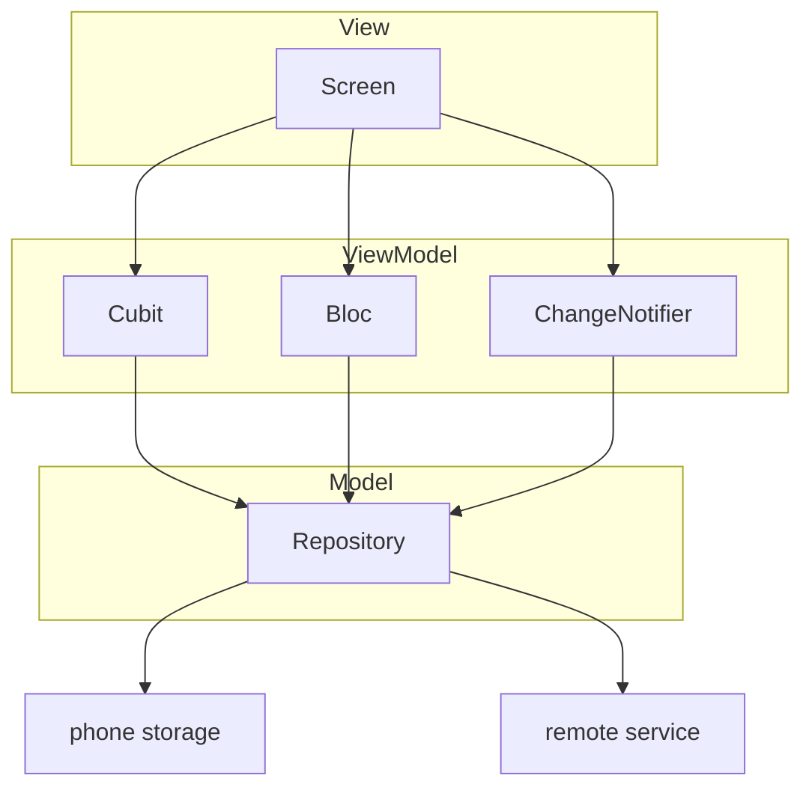
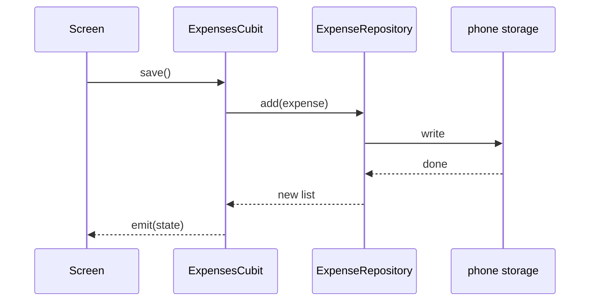
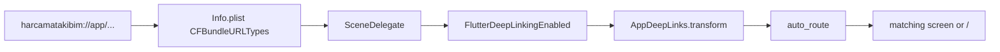
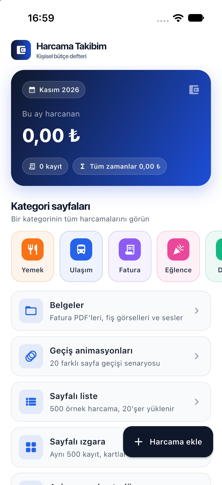
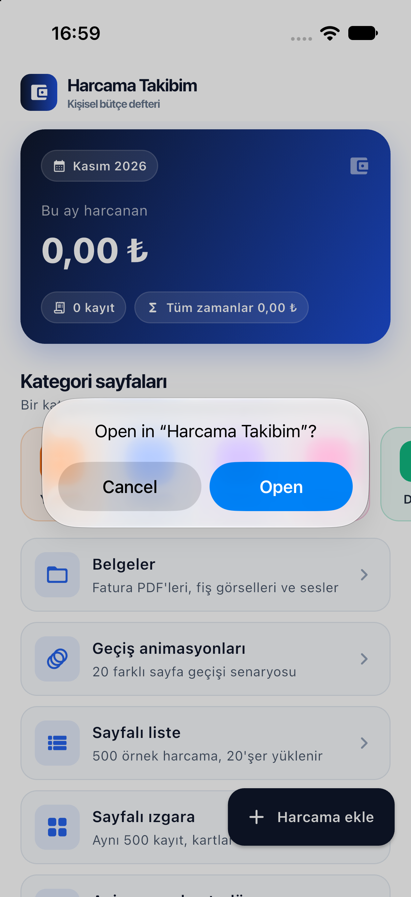

<p align="center">
  <a href="https://flutter.dev"></a>
  <a href="https://dart.dev"></a>
  <a href="ios/"></a>
  <a href="android/"></a>
  <a href="#lesson-flow"></a>
  <a href="#data-flow"></a>
  <a href="#lesson-4--auto_route"></a>
  <a href="#platform-identity"></a>
  <a href="#platform-identity"></a>
  <a href="https://github.com/Lysoths"></a>
  <a href="https://github.com/gurkanfikretgunak"></a>
</p>

# Flutter Lessons

Expense Tracker is a Flutter app that stores expenses on the phone.
Each lesson adds one sample screen to the same app. Folders follow
[masterfabric-flutter-duo](https://github.com/masterfabric/masterfabric-flutter-duo)
(`BaseViewModelCubit`, Equatable state, get_it, `view_<name>/`).
Cubit usage follows the [bloclibrary counter tutorial](https://bloclibrary.dev/tutorials/flutter-counter/).

| Role | Who |
| --- | --- |
| Educator | [Oğuzhan ER](https://github.com/Lysoths), repository owner ([Lysoths/Flutter-Lessons](https://github.com/Lysoths/Flutter-Lessons), [ogzhner.com](https://www.ogzhner.com)) |
| Lesson author | [gurkanfikretgunak](https://github.com/gurkanfikretgunak) |

**Requires:** Flutter 3.47 (Dart 3.13). The main targets are Android and iOS.
GPS, sensors, sqflite, and device or network info do not run on the web.

## Contents

- [Lesson flow](#lesson-flow)
- [Data flow](#data-flow)
- [Platform identity](#platform-identity)
- [Settings languages](#settings-languages)
- [Running on iOS](#running-on-ios)
- [Layout](#layout)
- [Lessons](#lessons)
- [Commands](#commands)

## Lesson flow

Lessons 1–3 (Navigator, RouterDelegate, a hand-written deep link parser) live
in the first commit (`b8b3616`). From lesson 4 on, all routing uses
**auto_route**. Each lesson is its own commit: `git log --oneline`.


Three layers sit side by side in the same app:



## Data flow



Screens reach data only through a ViewModel. The ViewModel knows the
repository interface (`ExpenseRepository`, `CurrencyRepository`) and does not
know how the repository works. Tests pass fake repositories to those
interfaces.

## Platform identity

One product, written with each platform's naming rule. Android uses an
underscore. Apple uses camelCase. Both live under `com.ogzhner`.

| | iOS | Android | macOS |
| --- | --- | --- | --- |
| Display name | Expense Tracker | Expense Tracker | flutter_ders |
| Package / bundle | `com.ogzhner.flutterDers` | `com.ogzhner.flutter_ders` | `com.ogzhner.flutterDers` |
| Test target | `com.ogzhner.flutterDers.RunnerTests` | — | `com.ogzhner.flutterDers.RunnerTests` |
| Version | `1.0.0` (1), from `pubspec.yaml` | same | same |
| Minimum | iOS 15.0 | API 24 | — |
| Plugins | Swift Package (`FlutterGeneratedPluginSwiftPackage`) | Gradle | CocoaPods / SPM |

The deep link is the same on both mobile targets. The scheme string stays
`harcamatakibim` because it is an identifier, not a label.

| Part | Value | File |
| --- | --- | --- |
| Scheme | `harcamatakibim` | `ios/Runner/Info.plist` → `CFBundleURLSchemes`, Android `intent-filter` |
| Host | `app` | Android `android:host`, Dart `AppDeepLinks` |
| URL name | `com.ogzhner.flutterDers` | `CFBundleURLName` |
| Allow list | `/kategori/:slug`, `/yeni`, `/belgeler` | `lib/app/core/router/app_deep_links.dart` |



Permissions stay on screen: they are not saved, sent, or printed to the console.

| Permission | Where | Lesson |
| --- | --- | --- |
| Internet | Android `INTERNET` | 11, 13–17 |
| Location while in use | iOS `NSLocationWhenInUseUsageDescription`, Android fine/coarse | 12 GPS, 14 Wi-Fi name |
| `https` / `http` query | iOS `LSApplicationQueriesSchemes` | 15 article link |
| Encryption declaration | iOS `ITSAppUsesNonExemptEncryption = false` | store export question |

On iOS, the Wi-Fi name (`network_info_plus`) also needs Apple's Access WiFi
Information capability. That capability needs a development team and a
provisioning profile. On the simulator the name usually stays `—`. Location
permission alone does not return the SSID.

## Settings languages

Home has a Settings card. It offers six languages and saves the choice on
the device with `SharedPreferences`. The app locale and the settings copy
follow that choice. Lesson screens stay in their original Turkish copy.

| Settings code | Flutter locale | Name |
| --- | --- | --- |
| `en` | `en` | English |
| `tr` | `tr` | Türkçe |
| `fr` | `fr` | Français |
| `cn` | `zh_CN` | 中文 |
| `jp` | `ja` | 日本語 |
| `de` | `de` | Deutsch |

`cn` and `jp` are the codes shown in settings. Flutter itself uses `zh` and
`ja`. The default is Turkish, so the existing lesson tests keep matching
the same strings. `/settings` is not on the deep-link allow list.

## Running on iOS

`ios/` is not a CocoaPods project. The Runner loads plugins through
`ios/Flutter/ephemeral/Packages/FlutterGeneratedPluginSwiftPackage`. That
folder, `Generated.xcconfig`, and `GeneratedPluginRegistrant` are not
committed. `flutter pub get` creates them. Adding a `Podfile` conflicts with
Swift Package Manager.

Simulator signing does not need `DEVELOPMENT_TEAM`. The Debug build signs
locally.

```bash
flutter pub get
open -a Simulator
flutter devices
flutter run -d "iPhone 17"
```

Startup order: `AppDelegate` → `SceneDelegate` (`FlutterSceneDelegate`) →
implicit Flutter engine → `GeneratedPluginRegistrant` → `lib/main.dart`.
The display name is `CFBundleDisplayName`. The bundle id is Xcode's
`PRODUCT_BUNDLE_IDENTIFIER` (`com.ogzhner.flutterDers`).

<p align="center">
  
</p>

Home-screen cards open the lesson screens. To try an allow-listed path while
the app is open:

```bash
xcrun simctl openurl booted "harcamatakibim://app/belgeler"
```

iOS asks, using the display name, before it hands a custom scheme to the app.
That prompt shows that `CFBundleDisplayName` and `CFBundleURLSchemes` point at
the same target.

<p align="center">
  
</p>

## Layout

```
lib/
├── main.dart                     # observer + DI + runApp
└── app/
    ├── app.dart                  # ExpenseApp: theme, router, network banner
    ├── core/
    │   ├── base/                 # ViewModel bases: Cubit, Bloc, ChangeNotifier
    │   ├── cache/                # versioned image cache, memory controller
    │   ├── bloc/                 # AppBlocObserver (prints transitions)
    │   ├── device/               # GPS, sensors, device-info sources
    │   ├── di/injection.dart     # get_it registrations (repositories and ViewModels)
    │   ├── network/              # retrofit services, shared Dio, recording interceptor
    │   ├── repository/           # Model layer: expenses, sample data, rates, news,
    │   │                         # network, app info, note stores (prefs/Hive/sqflite)
    │   └── router/               # auto_route table, deep-link allow list, transitions
    ├── helper/                   # money/date/measure formats, network check, fake socket
    ├── models/                   # Expense, documents, Lottie, rates, news, trace ...
    ├── theme/                    # MfColors + AppTheme, category colors
    ├── widgets/                  # shared pieces: Eyebrow, Gap, skeleton, info card
    └── views/
        ├── view_expenses/        # home: summary, categories, list, lesson cards
        ├── view_new_expense/     # new expense form (bottom sheet)
        ├── view_expense_detail/  # expense detail
        ├── view_category/        # expenses for one category
        ├── view_documents/ view_image_viewer/ view_pdf_viewer/ view_audio_player/  # Lesson 5
        ├── view_animations/      # Lesson 6
        ├── view_paged_list/ view_paged_grid/                                       # Lesson 7
        ├── view_animation_control/                                                 # Lesson 8
        ├── view_lottie/                                                            # Lesson 9
        ├── view_sync_async/ view_storage/                                          # Lesson 10
        ├── view_network/                                                           # Lesson 11
        ├── view_device/                                                            # Lesson 12
        ├── view_bloc_demo/                                                         # Lesson 13
        ├── view_device_info/ view_app_network/                                     # Lesson 14
        ├── view_currency/                                                          # Lesson 15
        ├── view_retrofit/                                                          # Lesson 16
        └── view_image_cache/                                                       # Lesson 17
assets/
├── belgeler/                     # Lesson 5: sample PDF, image, audio
├── data/                         # Lesson 7: 500 sample expenses · 13: saving tips · 17: base64 images
└── lottie/                       # Lesson 9: five Lottie animations
test/                             # unit, Bloc/ViewModel, and screen tests for each lesson
```

Every screen folder uses the same shape: `*_view.dart` (View), `cubit/`,
`bloc/`, or `view_model/` (ViewModel), and `widgets/` (pieces of that screen).

## Lessons

Order and the routing decision live in [Lesson flow](#lesson-flow). The table
below matches the card on the home screen. Those card labels are still the
Turkish strings drawn by the lesson UI.

| Lesson | Topic | Home card |
|---|---|---|
| 4 | auto_route, typed routes, deep-link allow list | — |
| 5 | Assets: PDF, image, audio | Documents |
| 6 | Route transition animations | Transition animations |
| 7 | Paging, `ListView.builder` / `GridView`, skeleton loading | Paged list, Paged grid |
| 8 | AnimationController, 3D object, pulse effects | Animation control |
| 9 | Lottie: animation from JSON | Lottie animations |
| 10 | Sync/async; SharedPreferences, Hive, sqflite | Sync / Async, Local storage |
| 11 | Future/StreamBuilder, MaterialBanner, fake WebSocket | Network check |
| 12 | GPS and motion sensors | Location and sensors |
| 13 | Bloc: service, live stream, asset | Data with Bloc |
| 14 | Device, app, and network info (Bloc, Cloudflare trace) | Device info, App and network |
| 15 | MVVM: ChangeNotifier + provider, currency desk | Currency desk |
| 16 | retrofit: annotations, interceptor, CallAdapter | Network with Retrofit |
| 17 | Versioned image cache, memory control; base64, S3, SFTP | Image cache |

**Outside services** (all free, no API key, no personal data added to the
request): Frankfurter (lesson 13), Cloudflare trace (lesson 14),
currency-api (lesson 15), Anadolu Agency and TRT Haber RSS (lesson 15),
jsonplaceholder and httpbin (lesson 16), AWS Open Data S3 and the Rebex SFTP
test server (lesson 17).

**Permissions:** internet; location (lesson 12 GPS, lesson 14 Wi-Fi name).
Location, IP, and Wi-Fi details are shown on screen only. They are not saved,
sent, or printed.

### Lesson 4 — auto_route

auto_route sets up Navigation 2.0 (RouterDelegate + parser). Pages are marked
with `@RoutePage()`. `build_runner` generates a **typed route class** for
each page:

| Page | Generated route | Path |
|---|---|---|
| `ExpensesView` | `ExpensesRoute()` | `/` |
| `CategoryExpensesView` | `CategoryExpensesRoute(slug: 'yemek')` | `/kategori/:slug` |
| `ExpenseDetailView` | `ExpenseDetailRoute(expense: e)` | not openable from outside |
| `NewExpenseView` | `NewExpenseRoute()` | `/yeni` (bottom sheet) |

```dart
// Open and wait for a result (like Navigator.push, with a typed route)
final result = await context.router.push<ExpenseDetailResult>(
  ExpenseDetailRoute(expense: expense),
);
// Close and return a result
context.router.maybePop(const ExpenseDetailDeleted());
```

| What | Where |
|---|---|
| Route table (`@AutoRouterConfig`, `RootStackRouter`) | `core/router/app_router.dart` |
| Generated route classes (do not edit) | `core/router/app_router.gr.dart` |
| `MaterialApp.router(routerConfig: _router.config(...))` | `app.dart` |
| Deep-link allow list (`deepLinkTransformer`) | `core/router/app_deep_links.dart` |
| `@PathParam('slug')` | `views/view_category/category_expenses_view.dart` |
| Tests | `test/deep_link_test.dart`, `test/widget_test.dart` |

When the route table or a `@RoutePage()` page's parameters change:

```bash
dart run build_runner build
```

Deep links: `harcamatakibim://app/kategori/<name>` and
`harcamatakibim://app/yeni`. `AppDeepLinks.transform` runs before auto_route
matches the table. Only those two shapes pass. Query parameters are dropped.
Everything else becomes `/`. The detail screen needs an object, so it cannot
be opened from outside.

### Lesson 5 — Assets (PDF, image, audio) + auto_route

Files are bundled in the app (`assets/belgeler/`) and declared under
`assets:` in `pubspec.yaml`. Source: Wikimedia Commons, all public domain.

| What | Where |
|---|---|
| Files | `assets/belgeler/` |
| `pubspec.yaml` → `flutter: assets: - assets/belgeler/` | `pubspec.yaml` |
| Document list (`kDocuments`) | `models/document_item.dart` |
| List page `/belgeler` | `views/view_documents/documents_view.dart` |
| Image: `Image.asset` + `InteractiveViewer` | `views/view_image_viewer/` |
| PDF: `PdfViewer.asset` (pdfrx) | `views/view_pdf_viewer/` |
| Audio: `AudioPlayer().setAsset` (just_audio) | `views/view_audio_player/` |
| Tests | `test/documents_test.dart` |

Viewers need a `DocumentItem` (`PdfViewerRoute(document: d)`), so from outside
only the list can open: `harcamatakibim://app/belgeler`.

Note: `@AutoRouterConfig(replaceInRouteName: 'View,Route')` also rewrites the
"View" inside `ImageViewerView` and would emit `ImageRouteerRoute`. Those
pages set the name by hand: `@RoutePage(name: 'ImageViewerRoute')`.

### Lesson 6 — Route transition animations

While a page opens, Flutter moves `animation` from 0 to 1 (and back when it
closes). A transition binds that value to a `*Transition` widget:
`FadeTransition`, `SlideTransition`, `ScaleTransition`,
`RotationTransition`, `SizeTransition`, or your own effect with
`AnimatedBuilder` (3D flip, circular reveal, blur).

In auto_route the transition is set on the route table:

```dart
CustomRoute(page: X.page, path: '/x',
  transitionsBuilder: RouteAnimation.slideFromRight.transitionsBuilder,
  duration: const Duration(milliseconds: 400))
```

**20 scenarios** (`core/router/route_transitions.dart` → `RouteAnimation`):
fade, slide from right/left/bottom/top, scale, scale down into place,
rotation, fade and rise, curtain, circular reveal, vertical/horizontal card
flip, elastic, bounce, focus, Hero (shared element), iOS style, Android
style, no animation.

**Existing pages:** category and documents slide from the right, expense
detail fades and rises, the image scales into place, the PDF comes from the
bottom, audio opens in a circle.

**Showcase:** home → *Transition animations*. One demo route
(`/animasyon/:senaryo`) shows all 20. `customRouteBuilder` reads the scenario
and picks the animation. The *slow motion* switch sets `timeDilation = 5`.

Note: auto_route identifies routes by **name** by default. Routes that share
a name (all 20 scenarios are `AnimationDemoRoute`) count as one page and
cannot stack. The demo route uses `usesPathAsKey: true` so it is identified
by **path**.

### Lesson 7 — Paging + ListView.builder

Home → *Paged list*: 500 sample expenses load 20 at a time (25 pages).

| Layer | File |
|---|---|
| Repository (interface) | `core/repository/sample_expense_repository.dart` → `fetchPage(page, pageSize)` |
| Data file | `assets/data/ornek_harcamalar.json` — 500 rows (pubspec → `assets/data/`) |
| Repository (JSON) | `core/repository/json_sample_expense_repository.dart` — `rootBundle.loadString` → `jsonDecode` → `Expense.fromJson`; the file is read once, then 0.6 s per page |
| State | `views/view_paged_list/cubit/paged_list_state.dart` — `status`, `items`, `page`, `hasMore`, `total` |
| View model | `views/view_paged_list/cubit/paged_list_cubit.dart` — `loadFirstPage`, `loadNextPage`, `refresh`, `retry` |
| Screen | `views/view_paged_list/paged_list_view.dart` |

- `ListView(children: [...])` builds all 500 rows up front.
  `ListView.builder` builds only the rows on screen.
- `ScrollController` calls `loadNextPage()` 300 px before the end.
  The cubit allows one request at a time and stops when the rows run out.
- `itemCount = rows + 1`: the last row is *loading / retry / that is all*.
- Pull to refresh (`RefreshIndicator`) returns to page 1.
- Sample rows are read-only. They are not written into real expenses. The
  route is not on the deep-link allow list.

**Second screen — paged grid** (home → *Paged grid*,
`views/view_paged_grid/`): same repository and the same `PagedListCubit`,
different layout. Cards are at most 200 px wide
(`SliverGridDelegateWithMaxCrossAxisExtent`): two columns on a phone, more
on a wide screen. The footer row does not fit in one cell, so the screen
uses `SliverGrid.builder` + `SliverToBoxAdapter` inside a `CustomScrollView`
(`GridView.builder` builds the same `SliverGrid` internally). The counter
and footer are shared: `view_paged_list/widgets/paged_status_widgets.dart`.

**Lazy loading — two tabs** (*Standard* / *Skeleton* on both list and grid):
each tab has its own cubit and pages on its own
(`view_paged_list/widgets/paged_tab.dart`, `AutomaticKeepAliveClientMixin`
keeps the tab alive).

| | Standard | Skeleton |
|---|---|---|
| On open | a centered spinner | 8 skeleton rows/cards |
| While the next page loads | a spinner at the bottom | 3 rows / 4 cards of skeleton at the end |

The skeleton uses no package (`widgets/skeleton.dart`). `SkeletonBox` is a
gray box. `Shimmer` runs a moving `LinearGradient` through a `ShaderMask`.
If the system setting "reduce motion" is on, the shine does not play.

### Lesson 8 — AnimationController

Home → *Animation control* (`views/view_animation_control/`), two tabs.

`AnimationController` is a clock: each frame it moves `value` from 0.0 to
1.0. The State mixes in `SingleTickerProviderStateMixin` for `vsync`, and
`dispose()` stops the clock when the page closes.

| Call | What it does |
|---|---|
| `forward()` / `reverse()` | play forward / backward |
| `stop()` / `reset()` | freeze in place / jump back to 0.0 |
| `repeat()` / `repeat(reverse: true)` | loop / ping-pong |
| `value = x` | jump to a point (progress slider) |
| `duration = ...` | speed (slider, 0.25x–3x) |

**3D object:** a package-free box (`widgets/box_3d.dart`). Six faces are
placed with `Matrix4`, back faces drawn first. Cube / Card / Tower.
- `CurvedAnimation` + `Curves` → linear, ease, decelerate, ease-back,
  elastic, bounce (`widgets/curve_option.dart`)
- `AnimatedSwitcher` → the old object fades, the new one grows
- `AnimatedContainer` → scene color (night) and height (large stage)
- The status line shows `AnimationStatus` (forward / reverse / completed / dismissed)

**Pulse:** 8 effects (`widgets/pulse_effects.dart`), each with its own
controller (`widgets/pulse_card.dart`): heartbeat (`TweenSequence`),
wave rings, breath, EKG line (`CustomPainter` + `extractPath`),
radar (`SweepGradient`), bell shake, "typing..." dots, and a pulse whose
speed follows bpm. Each card has play/stop and a curve picker.

### Lesson 9 — Lottie: animation from JSON

Home → *Lottie animations* (`views/view_lottie/`), package `lottie`.

1. A designer draws the animation as vectors in After Effects.
2. The Bodymovin plugin exports **JSON**: layers, shapes, and "at this frame,
   this value" lists.
3. `Lottie.asset('assets/lottie/x.json')` reads the file and redraws the
   shapes every frame. It is data, not video: a few KB, sharp at any size,
   and recolorable at runtime (`LottieDelegates`).

Root keys (`models/lottie_json_info.dart` reads them): `v` version, `fr`
frames per second, `ip`/`op` first/last frame, `w`/`h` canvas, `layers`.
Duration = (op − ip) / fr.

The player is driven by the lesson 8 `AnimationController`: play/stop, seek
(`value`), speed (`duration`). Without a controller, Lottie builds its own
clock and loops.

**Source:** [lottiefiles.com/free-animations](https://lottiefiles.com/free-animations/json),
Lottie Simple License. Files were downloaded as `.lottie` (zip) and the JSON
inside was extracted to `assets/lottie/`:

| File | LottieFiles |
|---|---|
| `heartbeat.json` | [Heartbeat](https://lottiefiles.com/free-animation/heartbeat-lottie-animation-Sph5eoJytj) |
| `loading.json` | [Loading animation](https://lottiefiles.com/free-animation/loading-animation-0yMJ1aysad) |
| `celebration.json` | [Party celebration](https://lottiefiles.com/free-animation/party-celebration-Ei80CjLJQC) |
| `clock.json` | [Clock](https://lottiefiles.com/free-animation/clock-lottie-animation-K2sPMoyo0P) |
| `idea.json` | [Idea](https://lottiefiles.com/free-animation/idea-2xuoUIZh6Z) |

### Lesson 10 — Sync / async and local storage

**Sync / Async** (home → *Sync / Async*, `views/view_sync_async/`,
`helper/sync_async_demo.dart`). Dart runs on one thread. The code that paints
the screen and the code behind a button share that queue. The gear and the
square counter on the page advance every frame. The longest gap between
frames is measured as a freeze.

| The same 2-second job | Result |
|---|---|
| `busyWork(2000)` (synchronous) | the screen freezes |
| `await Future.delayed(2 s)` | the screen keeps moving (waiting, no work) |
| `await Future(() => busyWork(2000))` | freezes again: async is not parallel |
| `await Isolate.run(() => busyWork(2000))` | the screen keeps moving: another core |

Event-loop order: synchronous code, then microtasks, then the event queue
(`Future()`, `Timer`). An async function runs synchronously until its first
`await`.

**Local storage** (home → *Local storage*, `views/view_storage/`). The same
record (`StorageNote`) is stored three ways, on three screens. All of them
use the `NoteStore` interface and the same `StorageDemoCubit`
(`core/repository/note_stores/`):

| | SharedPreferences | Hive (hive_ce) | sqflite |
|---|---|---|---|
| Model | key → value | NoSQL, key → object | SQL table, row |
| How a list is stored | JSON text under one key | objects in a box (TypeAdapter) | rows in a table |
| Read | sync (from memory) | sync (`box.get`) | async (SQL) |
| Query | none | by hand in code | `WHERE`, `ORDER BY`, `SUM` |
| Best for | settings, a few values | objects, a fast cache | many rows, queries, relations |

Each screen can add and delete records, measure a write/read of 1000
records, and show the raw bytes on disk. This lesson's data lives in its own
key (`ders10_notes`), box, and database (`ders10.db`). Real expenses are not
touched. Tests run Hive in a temp folder and sqflite in memory through
`sqflite_common_ffi`.

### Lesson 11 — Network check: Future, Stream, and WebSocket

Home → *Network check* (`views/view_network/`).

**Helper** (`helper/network_checker.dart`): tries to resolve `example.com`
with DNS. Being on Wi-Fi does not mean the device can reach the internet.

| | Returns | On screen |
|---|---|---|
| `check()` | `Future<NetworkResult>`: one answer | `FutureBuilder` |
| `watch(every:)` | `Stream<NetworkResult>`: every N seconds | `StreamBuilder` |
| `refresh()` | a new check pushed to listeners now | "Try again" |

`ConnectionState`: `none` (not started) → `waiting` → `active` (the stream
is emitting) → `done`. The Future or Stream is created once on the `State`,
not inside `build`. Otherwise every frame starts it again.

**MaterialBanner:** `app.dart` listens to `watch()` at startup. When there is
no connection, `ScaffoldMessenger` shows "No internet connection" above every
page. When the connection returns, the banner leaves and a short notice
appears. The *Act offline* switch on the page shows that banner without
turning Wi-Fi off.

**Fake WebSocket** (`helper/mock_socket.dart`): no package and no setup.
`HttpServer` opens inside the phone, on `127.0.0.1`, reachable only from the
phone. It sends a fake exchange rate every second and echoes typed messages.
The client is a real `WebSocket`. `StreamBuilder` shows incoming messages
live.

A release Android build needs the `INTERNET` permission in the main manifest.
Flutter adds it for debug builds.

### Lesson 12 — GPS and sensors: live data from hardware

Home → *Location and sensors* (`views/view_device/`), two tabs.
Hardware pushes a new value onto a `Stream`. The screen rebuilds with
`StreamBuilder` (the idea from lesson 11).

**GPS** (`core/device/location_source.dart`, package `geolocator`):
1. Permission (`Future`): is the location service on, and is permission
   granted? If not, it asks. If it was denied forever, "Open settings" is
   shown.
2. Location stream (`Stream`): about once a second, latitude, longitude,
   accuracy (± m), speed, heading, altitude. A trail is drawn as you walk.
   Distance uses the haversine formula. Steps smaller than the accuracy
   radius are ignored as jitter.
Location is shown on screen only. It is not saved or sent.
Permissions: Android `ACCESS_FINE/COARSE_LOCATION`, iOS
`NSLocationWhenInUseUsageDescription`.

**Sensors** (`core/device/sensor_source.dart`, package `sensors_plus`).
Axes are relative to the phone: x right, y up, z out of the screen toward you.

| Sensor | Unit | On screen |
|---|---|---|
| Accelerometer (includes gravity) | m/s² | spirit level, tilt angles, live x/y/z chart |
| Magnetometer | µT | approximate compass (phone held flat), field strength |
| Gyroscope | rad/s | rotation speed on each axis |
| User acceleration (gravity removed) | m/s² | shake counter (above 12 m/s²) |

Each card shows samples per second (Hz) and `ConnectionState`. Hardware sits
behind the `LocationSource` / `SensorSource` interfaces. Tests supply fake
streams.

Note: these two pages and the network page use `SingleChildScrollView`
instead of a lazy `ListView`. If a card leaves the screen and is disposed,
a new `StreamBuilder` cannot listen to the same single-subscription stream.

### Lesson 13 — State with Bloc

Home → *Data with Bloc* (`views/view_bloc_demo/`), three tabs.

```
Screen ──add(Event)──▶ Bloc ──on<Event>──▶ emit(State) ──▶ Screen paints
```

With a Cubit the screen calls a method (`cubit.load()`). With a Bloc it
sends an **event** (`bloc.add(RatesRequested())`). Same idea as React
`useReducer` + `dispatch`. Every Bloc extends
`core/base/base_view_model_bloc.dart` (masterfabric_core's
`BaseViewModelBloc`). `AppBlocObserver.onTransition` records each change as
"event → state".

| Tab | Source | Bloc | Technique |
|---|---|---|---|
| Service | Frankfurter API (`dio`) | `RatesBloc` | `sealed` states + `switch`; `droppable()`: "Refresh" is ignored while a request is in flight |
| Live | Fake WebSocket (lesson 11) | `LiveRatesBloc` | `emit.forEach(stream)`: each message is a new state |
| Asset | `assets/data/tasarruf_ipuclari.json` | `TipsBloc` | `restartable()` + 300 ms wait: only the latest search runs |

On screen: `MultiBlocProvider` (three Blocs at page level), `BlocBuilder`
(paint), `BlocListener` (a notice on error), `BlocSelector` (repaint when
one slice of state changes).

**Service:** `GET https://api.frankfurter.dev/v1/latest?base=TRY&symbols=...`
Daily rates from the European Central Bank. Free, no key, no personal data
on the request. `dio` errors become a `RatesFailure`.

**Layers:** `core/repository/` → `rates_repository.dart`,
`live_rates_repository.dart`, `tips_repository.dart`. Tests
(`test/bloc_demo_test.dart`, `bloc_test`) do not hit the network: a fake
adapter on dio, fake repositories on the Blocs.

### Lesson 14 — Device, app, and network info (Bloc)

Home → *Device info* (`views/view_device_info/`) and *App and network*
(`views/view_app_network/`, two tabs). Three Blocs, one pattern:
event → source → `emit(state)`.

| Screen | Source | Bloc | What |
|---|---|---|---|
| Device info | `device_info_plus`, `dart:io` | `DeviceInfoBloc` | Brand, model, Android/API, security patch, build, chip, ABI, RAM, disk, system features, raw data |
| (same screen) | `MediaQuery`, `View` | — | Resolution, dpr, Hz, safe area, text scale, theme. Changes when the phone rotates. Belongs to the screen, not the Bloc |
| App | `package_info_plus`, `FlutterVersion` | `AppInfoBloc` | Version, package name, install time, signature, build mode, Flutter/Dart version |
| Network | `connectivity_plus`, `network_info_plus`, `dart:io` | `NetworkInfoBloc` | Connection type, VPN, Wi-Fi name/BSSID, local IP, gateway, mask, interfaces |
| Network | `GET https://1.1.1.1/cdn-cgi/trace` (`dio`) | `NetworkInfoBloc` | Public IP, country, Cloudflare data center, TLS, HTTP version, server time, round trip |

**Why is the public IP not read from the device?** The phone sits behind a
modem or carrier (NAT). The address it knows is the local one. Only a server
outside can say which address reached the internet. The trace body is plain
text (`key=value` lines). `CloudflareTrace.parse` splits it.

**Bloc techniques:** the on-device part and the trace start together.
Whichever finishes first reaches the screen first. "Refresh" is
`droppable()`. When connectivity changes (`onConnectivityChanged`), the Bloc
sends itself an event. `restartable()` keeps only the latest one.

**Privacy:** IP, Wi-Fi name, BSSID, and gateway start hidden and appear on
tap. Nothing is saved. `toString` on those states omits the values, so
`AppBlocObserver` does not print them. The Wi-Fi name asks for the Android
location permission from lesson 12. Without it the name is "—". These two
screens are not on the deep-link allow list.

### Lesson 15 — MVVM: currency desk with ChangeNotifier

Home → *Currency desk* (`views/view_currency/`). One screen, one parent
ViewModel, three child ViewModels, bound with the `provider` package.

```
views/view_currency/
├── currency_view.dart              View: page skeleton
├── view_model/
│   ├── currency_view_model.dart    parent: first load, refresh all, coordination
│   ├── rates_view_model.dart       section 1: 10 currencies
│   ├── history_view_model.dart     section 2: week / month / 3 months
│   └── news_view_model.dart        section 3: news, filter, read
└── widgets/                        each section plus the news sheet
Model: models/currency/*, core/repository/{currency,news}_repository.dart
Base: core/base/base_change_notifier_view_model.dart
```

| Layer | Job | On this screen |
|---|---|---|
| View | Paints and forwards gestures to the ViewModel | `RatesSection`, `HistorySection`, `NewsSection`, `NewsDetailSheet` |
| ViewModel | Prepares and bounds the data the screen will show. Fields cannot be changed from outside | `CurrencyViewModel` → `Rates` / `History` / `News` ViewModel |
| Model | Fetches data and does not know the screen | `CurrencyApiRepository`, `RssNewsRepository` |

**Why child ViewModels?** Each section listens only to its own ViewModel
(`context.watch<NewsViewModel>()`). Changing the news filter does not
repaint the rate list. Sections do not know each other. "USD was tapped,
point the chart at USD" is decided by the parent (`selectCurrency`).

**ChangeNotifier versus Cubit:** in a Cubit, state is one immutable object
(`emit(newState)`). In a ChangeNotifier, state is the ViewModel's own
fields. A field change calls `notifyListeners()`. Same idea as C#
`INotifyPropertyChanged`. `provider` counterparts: `ChangeNotifierProvider`
(create and dispose), `.value` (pass an existing one down), `watch`,
`select`, `read`.

**Data:**
- Rates: [currency-api](https://github.com/fawazahmed0/exchange-api).
  Free, no key, one file per day. jsDelivr is tried first
  (`cdn.jsdelivr.net/npm/@fawazahmed0/currency-api@2026.11.3/...`). If that
  fails, `{day}.currency-api.pages.dev` is tried. Some mobile carriers block
  pages.dev.
- History: every day for a week (8 points), every other day for a month
  (16), once a week for 3 months (14). Days stay in a cache. Changing the
  range does not re-download old days. Fast changes keep only the last
  request's result.
- News: Anadolu Agency and TRT Haber economy RSS feeds, parsed with `xml`.
  If one feed fails, the other is shown. "Read on site" in the sheet opens
  only `aa.com.tr` and `trthaber.com` (`url_launcher`).

### Lesson 16 — Network layer with retrofit

Home → *Network with Retrofit* (`views/view_retrofit/`). Packages:
`retrofit`, `json_annotation`. Dev packages: `retrofit_generator`,
`json_serializable`.

The REST service is written as a Dart **interface**. `build_runner` generates
the class that sends the request (like Refit in C#, Retrofit on Android):

```dart
@RestApi(baseUrl: 'https://jsonplaceholder.typicode.com')
abstract class PostsApi {
  factory PostsApi(Dio dio) = _PostsApi;      // posts_api.g.dart

  @GET('/posts/{id}')
  Future<Post> getPost(@Path('id') int id);   // JSON → Post.fromJson
}
```

| Layer | File |
|---|---|
| Service interfaces | `core/network/posts_api.dart` (jsonplaceholder), `core/network/echo_api.dart` (httpbin) |
| Generated code | `*.g.dart` (`dart run build_runner build`) |
| Model (`@JsonSerializable`) | `models/post.dart` → `Post`, `PostDraft`, `Comment` |
| Shared Dio + recording | `core/network/retrofit_client.dart`, `core/network/recording_interceptor.dart` |
| CallAdapter | `core/network/api_result.dart` → `ApiResult`, `ResultCallAdapter` |
| Demos and view model | `views/view_retrofit/cubit/` → `kRetrofitDemos`, `RetrofitLabCubit` |

The screen runs 23 live demos in five groups. Each card shows the
annotation, the interface declaration, editable inputs, and *Send*. The
result shows the Dart object retrofit returned next to the request and
response that actually crossed the network (headers, body, duration).
*Network log* at the top right lists every request.

| Group | Annotations |
|---|---|
| HTTP methods | `@GET` `@POST` `@PUT` `@PATCH` `@DELETE` `@HEAD` `@OPTIONS` |
| Parameters | `@Path` `@Query` `@Queries` `@Headers` `@Header` |
| Body types | `@Body` `@BodyExtra` `@FormUrlEncoded` + `@Field` `@MultiPart` + `@Part` `@NoBody` `@PreventNullToAbsent` |
| Dio features | `@CancelRequest` `@SendProgress` `@ReceiveProgress` `@DioResponseType` `@Extra` `@Extras` `@DioOptions` `@CacheControl` |
| Response and error | `HttpResponse<T>` `@UseCallAdapter` `DioException` |

**Which demo sent this request?** The cubit runs each demo inside
`runZoned(..., zoneValues: {zoneKey: id})`. `RecordingInterceptor` reads
`Zone.current[zoneKey]` while it records. Retrofit method signatures stay
untouched, and each request lands on its own card.

**Notes:**
- Methods that return raw JSON use `Map<String, Object?>`.
  `retrofit_generator` 10.3 emits code that does not compile for
  `Map<String, dynamic>` (`dynamic.fromJson`).
- `@PartMap` does not write a body in this generator version (the generated
  body is `null`). Several multipart fields use `@Part`.
- `dio` and `retrofit` both define `Headers`. Service files use
  `import 'package:dio/dio.dart' hide Headers;`.
- jsonplaceholder is a fake REST server: writes return a realistic response
  and persist nothing. httpbin echoes the request it received.

### Lesson 17 — Versioned image cache

Home → *Image cache* (`views/view_image_cache/`). The core lives under
`core/cache/`. Packages: `path_provider`, `crypto`, `dartssh2`.

**Problem:** images are cached on disk. If a new release changes the image
at the same URL (logo, banner, campaign), the app keeps showing the old
one. On a slow network or a full memory budget, images draw half-finished,
in pieces, or with flicker.

**Version check** (`AppImageCache.ensureReady`, at startup in `main.dart`):
the stored version (`SharedPreferences`) is compared with `version+build`
from `package_info_plus`. If they differ, the old version's disk folder is
deleted and Flutter's memory cache (`ImageCache`) is cleared. Disk layout:
`<app>/image_cache/<version>/<sha1(source)>.img`.

**Integrity: a partial image never reaches the screen**

| Step | What it does |
|---|---|
| Size check | HTTP `content-length`, or SFTP `stat().size`, compared with the bytes received |
| End marker | PNG `IEND`, JPEG `FF D9`, GIF `3B`, WebP RIFF size. Skia sometimes draws a truncated PNG without an error, but only half of it |
| Decode attempt | Bytes are decoded once (`instantiateImageCodec`) before they are written |
| Atomic write | Written as `.part`, renamed to `.img` when finished. An app that dies mid-write does not leave a partial file |
| Read from disk | The same checks. A corrupt file is deleted and downloaded again |
| Retry | A short or corrupt download is tried twice more, with a wait |
| Shared request | Two callers asking for the same image share one download |
| On screen | `gaplessPlayback`: the old image stays until the new one arrives. `frameBuilder` fades it in |

**Background memory controller** (`ImageMemoryController`): a decoded image
costs width × height × 4 bytes. The budget is 2% of device RAM (48–256 MB,
from `device_info_plus`) and is written to `ImageCache.maximumSizeBytes`.
Every 2 seconds it measures cache size, image count, images on screen, and
the app's memory (RSS). Images that are not on screen are dropped when the
cache passes 90% of the budget, when Android reports low memory
(`didHaveMemoryPressure`), and when the app goes to the background.
`ImageCache.clear()` does not touch images on screen, so the clear does not
flicker.

**Three sources** (`models/image_demo_sources.dart`):

| Source | From | How |
|---|---|---|
| Base64 | `assets/data/base64_gorseller.json` (shaped like an API response) | `data:image/png;base64,...` → `base64Decode` |
| S3 | AWS Open Data, `elevation-tiles-prod` bucket (public PNG tiles) | `dio`, `ResponseType.bytes` |
| SFTP | `test.rebex.net` (public, read-only test server) | `dartssh2`; the host key is pinned |

**Why SFTP, not FTP?** FTP (including IIS FTP) sends the user name, password,
and file in clear text. Passive mode opens extra ports, so it often fails on
mobile networks and firewalls. SFTP runs encrypted over SSH, uses one port
(22), and checks the server's identity with a key fingerprint. The app talks
only to known keys (`kSftpHostKeys`) and rejects a stand-in server. For
images shipped to a mobile app, HTTPS is still the better path (a static
site on IIS, or S3 plus a CDN): cache headers, a CDN, and versioned file
names (`logo.v42.png`).

On screen: where each image came from (memory / disk / source) and how long
it took, plus *Precache*, *Load test (24 tiles)*, *Clear memory*,
*Clear disk*, *Corrupt one file* (the bad file is detected and downloaded
again), and *Pretend a new version shipped* (version cleanup).

## Commands

```bash
flutter pub get
dart run build_runner build     # when the route table changes (app_router.gr.dart)
flutter analyze
flutter test
flutter run -d "iPhone 17"      # iOS simulator; see Running on iOS
```
